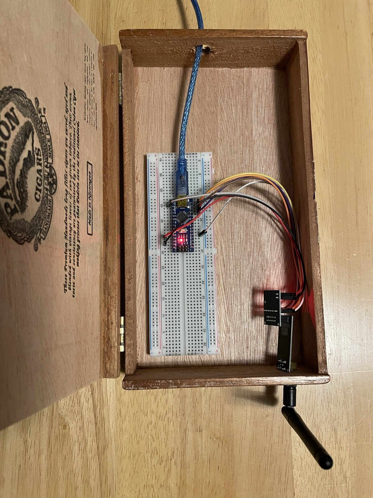

# Cigar box blinds hub

Control **Hunter Douglas PowerView Gen 2** motorized blinds from your phone, with no official hub. Total cost: about $20 in parts, plus an old laptop or any always-on Linux computer.



An Arduino Nano with a cheap nRF24L01+ radio speaks the same 2.4 GHz protocol as the Pebble remote. A small Python web app drives it over USB and gives you:

- A web page for phones and laptops, with one tab per room: tap the window picture to send the blind to that height, or use Open / Stop / Close.
- **Exact positions**: the blind drives itself to a percentage and reports where it actually is. Nothing depends on timing.
- Schedules (days of the week plus a time).
- Optional safety lines per room: a bottom "no-go" line (say, for things on a windowsill) and a top line. The hub refuses any command past them, schedules included.

> **Not affiliated with or endorsed by Hunter Douglas.** PowerView and Pebble are trademarks of Hunter Douglas. This project talks to blinds you own, on your own radio network, using a protocol worked out by the community (see [Credits](#credits)). Use at your own risk.

## Will it work with my blinds?

It works with **PowerView Gen 2** (sold about 2015–2022), controlled by a **Pebble remote** that has no Bluetooth pairing. Gen 3 blinds use Bluetooth with encryption and won't work. Gen 1 is untested.

There's an easy test once the radio is built: run `listen` (below) and press a button on your remote. If packets appear, you're in business.

## Parts (~$20)

| Part | Notes |
|---|---|
| Arduino Nano (ATmega328P, CH340 USB chip), headers soldered | Clones are fine. |
| nRF24L01+ radio module | Plain (PCB antenna) or amplified PA+LNA with an external antenna. The amplified one reaches further; the build in the photo uses one. |
| nRF24 socket adapter with a 3.3 V regulator (AMS1117, 8-pin header) | **Required.** The radio's 2x4 header doesn't fit a breadboard, and the Nano's own 3.3 V pin can't supply enough current. Often sold bundled with the radios. |
| Half-size or larger breadboard | |
| 8 jumper wires (male-to-female or male-to-male, to suit your adapter) | |
| USB cable for the Nano (usually Mini-B) | |
| A box | Wood or plastic. Not metal, which blocks the radio. Drill one hole for the USB cable and, for an amplified module, one for the antenna. |

And a computer to run the hub around the clock: an old laptop running Linux, a Raspberry Pi, a home server. It needs Python 3.8+, a USB port, and Wi-Fi or Ethernet. Put it, or the radio on a USB extension cable, where it can reach every room.

## Wiring

The Nano sits across the breadboard's centre gap. The radio plugs into the adapter's socket, and eight wires connect the adapter to the Nano:

| Adapter pin | Nano pin | Purpose |
|---|---|---|
| VCC | 5V | power (the adapter regulates it to 3.3 V) |
| GND | GND | ground |
| CE | D10 | chip enable |
| CSN | D9 | SPI chip select |
| SCK | D13 | SPI clock |
| MOSI (MO) | D11 | SPI data to the radio |
| MISO (MI) | D12 | SPI data from the radio |
| IRQ | D2 | "packet received" interrupt, needed for listening and position reads |

Go by the labels printed on the adapter, not by pin position: the order differs between vendors.

Before powering up:
- The radio's socket isn't keyed. Match its GND pin (usually the square pad) to the adapter's GND. Reversed, it gets 5 V on the wrong pins.
- If your radio has an antenna connector, screw the antenna on first.
- Don't use the Nano's 3V3 pin.

## Flash the Nano

1. Install the [Arduino IDE](https://www.arduino.cc/en/software) (or `arduino-cli`).
2. In the Library Manager, install **RF24** by TMRh20. It's the only library needed.
3. Open `firmware/BlindsRadio/BlindsRadio.ino`, choose board **Arduino Nano** and processor **ATmega328P** (try "ATmega328P (Old Bootloader)" if the upload fails), and upload.
4. Open the Serial Monitor at **115200** baud, with line ending set to "Newline". You should see `ready`. If you see `radio not responding`, check the wiring and power.

Command line instead of the IDE:

```
arduino-cli lib install RF24
arduino-cli compile --fqbn arduino:avr:nano firmware/BlindsRadio
arduino-cli upload  --fqbn arduino:avr:nano -p /dev/ttyUSB0 firmware/BlindsRadio
```

If the amplified radio misbehaves on USB power, change `PA_LEVEL` at the top of the sketch to `RF24_PA_LOW`.

## Install the hub

On the always-on computer (commands are for Debian, Ubuntu, Linux Mint or Raspberry Pi OS):

```
sudo apt install python3-venv git
sudo mkdir -p /opt/blinds && sudo chown $USER: /opt/blinds
git clone https://github.com/kds1729/cigar-box-blinds-hub.git /opt/blinds
cd /opt/blinds
python3 -m venv .venv
.venv/bin/pip install -r requirements.txt
sudo usermod -aG dialout $USER     # lets you open the Nano's serial port; log out and back in
```

Plug the Nano in. It usually appears as `/dev/ttyUSB0` (check with `ls /dev/ttyUSB*`).

> **Encrypted home folder?** If your home folder is encrypted (an option in the Ubuntu and Mint installers), it stays locked after a reboot until someone logs in with a password. That's why the hub lives in `/opt/blinds`.

## Set up your rooms

Each blind (or group of blinds) on your Pebble remote has a **group number**. The hub needs those, plus your network's ID and your remote's ID. Your remote tells you all of them.

1. **Copy the example config:** `cp hub/rooms.example.json hub/rooms.json`
2. **Capture your remote.** Run the following, then select each room on the remote and press **Stop** (it's harmless when the blind isn't moving):

   ```
   .venv/bin/python tools/radio.py listen 60
   ```

   Each press prints something like:

   ```
   PKT 1234C011000544FFFFABCD8606E60100ABCD52530047E2
       network 1234  header C0  from ABCD  rc1 44  rc2 E6  groups 01  command 525300 (stop)
   ```

3. **Fill in `hub/rooms.json`**, one entry per room:

   | Field | Value | From the example above |
   |---|---|---|
   | `label` | Name shown on the tab | `"Living room"` |
   | `dest` | network + header, 6 hex digits | `"1234c0"` |
   | `source` | the remote's ID (`from`) | `"abcd"` |
   | `shades` | the group number(s), as numbers | `[1]` |
   | `rc1`, `rc2` | the **latest** rc1 and rc2 you saw, converted to decimal | `68`, `230` |
   | `hub_rc` | leave at `0` | |
   | `blind_id` | leave empty for now | `""` |

   All rooms on the same remote share one pair of counters, so give every room the same `rc1` and `rc2`.

4. **Find each blind's radio ID.** Position commands go straight to a blind's own ID:

   ```
   .venv/bin/python tools/radio.py find-blind room1 --save
   ```

   It asks the blind where it is and saves the ID of the one that answers. Repeat for each room.

5. **Start the hub and try it:**

   ```
   .venv/bin/python hub/app.py --port /dev/ttyUSB0
   ```

   Open `http://<computer's address>:8420` on your phone. Tap a room's tab, then tap the window picture to move the blind.

**Using the real remote as well is fine.** The hub keeps its own count of commands sent (the rolling counters). Blinds ignore commands whose count is far behind the last one they saw, so if the hub's commands ever stop working after heavy remote use, run `listen` again and update `rc1`/`rc2`.

## Keep it running

To start the hub at boot and restart it if it crashes:

```
sudo cp deploy/blinds-hub.service /etc/systemd/system/
sudo sed -i "s/YOURUSER/$USER/" /etc/systemd/system/blinds-hub.service
sudo systemctl daemon-reload
sudo systemctl enable --now blinds-hub
journalctl -u blinds-hub -f        # logs
```

Only one program can use the Nano at a time, so stop the hub (`sudo systemctl stop blinds-hub`) before running `tools/radio.py`.

### A nice name instead of an IP address

If you name the computer `blinds` (`sudo hostnamectl set-hostname blinds`), phones and laptops on your network can reach it as **http://blinds.local:8420**. That works through mDNS, which Linux provides with `avahi-daemon` (installed by default on most desktop distributions).

To drop the `:8420`, install nginx (`sudo apt install nginx-light`) and use `deploy/nginx-redirect.conf`. Then **http://blinds.local/** works too. On a phone, add it to the home screen.

A DNS record on a domain you own may not work at home. Some ISP routers, AT&T's among them, discard DNS answers that point to private addresses like 192.168.x.x. `blinds.local` doesn't depend on the router at all.

Give the computer a fixed IP address outside your router's DHCP range, or reserve one in the router, so it doesn't change.

### Using an old laptop

This hub runs on a 2013 MacBook Air with Linux Mint. What it took:

- **Keep running with the lid closed:** copy `deploy/lid-ignore.conf` to `/etc/systemd/logind.conf.d/`, and stop sleep entirely with `sudo systemctl mask sleep.target suspend.target hibernate.target hybrid-sleep.target`. Desktop environments may have their own lid setting too. On Cinnamon: `gsettings set org.cinnamon.settings-daemon.plugins.power lid-close-ac-action nothing`.
- **Remove an old swollen battery.** An old laptop left on the charger all the time can swell its battery. Many laptops, MacBooks included, run fine on the charger alone without one. A swollen battery is a fire risk: take it to a battery recycling drop-off, never the trash.
- **Turn back on after a power cut:** without a battery, a power cut switches the laptop off. On Intel Macs and many Intel PCs, `deploy/power-on-after-outage.service` makes it boot when power returns. Test it by unplugging the charger for 10 seconds.
- **The clock** resets after a power cut on a battery-less laptop, until it syncs from the internet a few seconds after booting. If the internet is down too, schedules can run at the wrong time until it's back.

## Security

There's no login. Anyone on your Wi-Fi can open the page and move the blinds. **Never expose the hub to the internet** (no port forwarding). Use a VPN such as Tailscale or WireGuard if you want remote access.

## How it works

The radio protocol, the packet layout and the transmit trick that made it reliable are documented in [docs/protocol.md](docs/protocol.md).

Repository layout:

| Path | What it is |
|---|---|
| `firmware/BlindsRadio/` | Arduino sketch: a USB-serial to radio bridge (`listen`, `txr`, `txq`) |
| `hub/app.py` | Web app, REST API and scheduler (Flask, APScheduler) |
| `hub/controller.py` | Builds packets, tracks rolling counters, sends commands, reads positions |
| `hub/hd_packet.py` | Packet builder and checksum |
| `hub/rooms.example.json` | Example config; your own goes in `hub/rooms.json` (git-ignored) |
| `tools/radio.py` | Setup helper: `listen` and `find-blind` |
| `deploy/` | systemd services, nginx redirect, lid setting |

### REST API

| Request | Does |
|---|---|
| `GET /api/rooms` | All rooms, with their config and last reading |
| `GET /api/rooms/<room>/position` | Asks the blind where it is |
| `POST /api/rooms/<room>/position` `{"percent": 40}` | Sends the blind to 40% open |
| `POST /api/rooms/<room>/command` `{"cmd": "stop"}` | `up`, `down` or `stop` |
| `GET/POST /api/schedule`, `PUT/DELETE /api/schedule/<id>` | Schedule rules |

## Credits

- The Arduino Forum thread ["NRF24L01+ hack on Hunter Douglas shades"](https://forum.arduino.cc/t/nrf24l01-hack-on-hunter-douglas-shades/676940), which showed that a Nano and an nRF24 can talk to PowerView blinds.
- [mattyway/RFPowerView](https://github.com/mattyway/RFPowerView), whose packet documentation confirmed the checksum, the packet layout and the position commands.
- [TMRh20's RF24 library](https://github.com/nRF24/RF24).

## License

Copyright (C) 2026 Keith Sprochi.

This project is free software under the **GNU General Public License, version 2 or (at your option) any later version** (`GPL-2.0-or-later`). See [LICENSE](LICENSE). You may use, copy, change and share it, including commercially. If you distribute a modified version, you must share its source under the same license.

Version 2 or later matches the RF24 library, which the firmware links against and which is GPL version 2.
